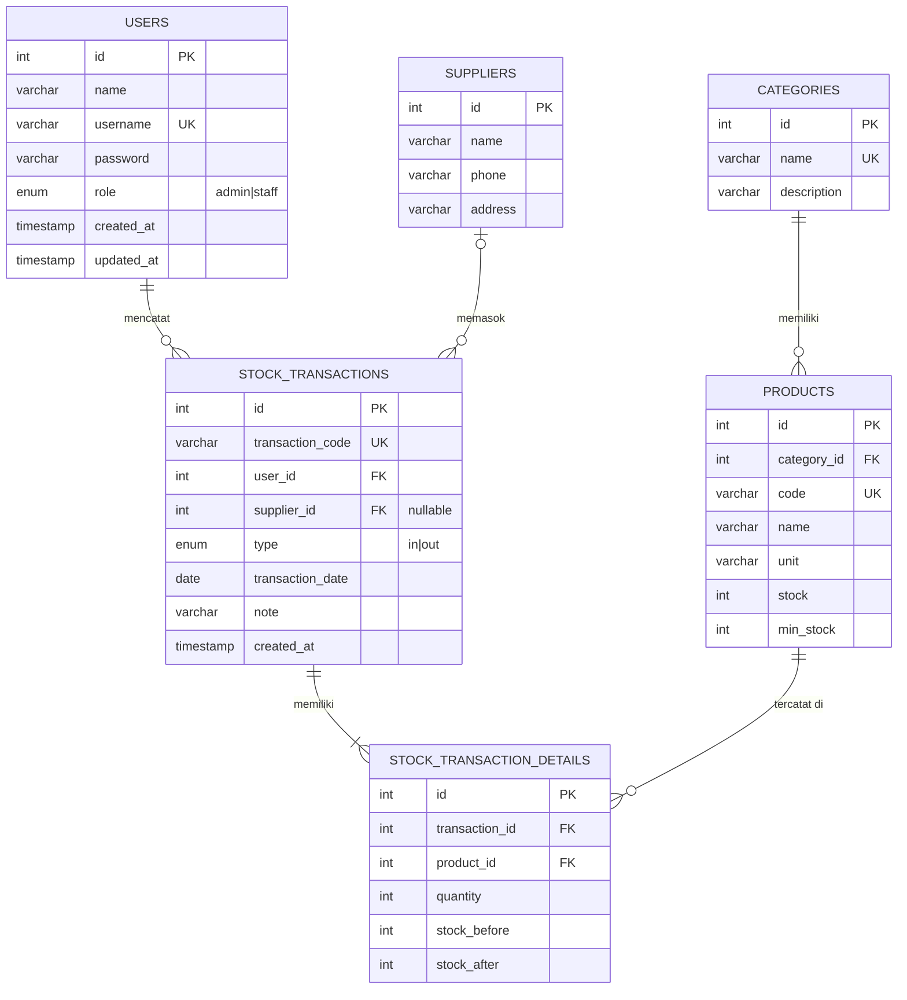
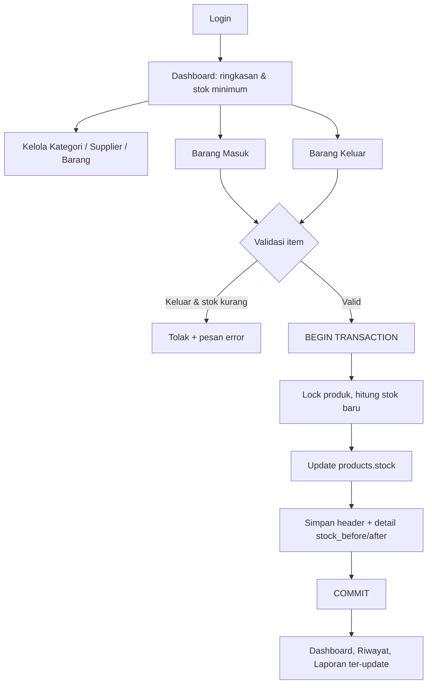

# Tahap 1 — Perencanaan Database (ERD)

Sumber: Proposal Capstone "Sistem Informasi Monitoring Stok Barang pada Warung Madura Berbasis Web" (Bab 2.2.5 & 2.2.6).

> Proposal tidak menyertakan gambar ERD, hanya daftar entitas dan relasi one-to-many.
> Atribut kolom di bawah dirancang dari kebutuhan fitur di proposal. Silakan sesuaikan bila ERD resmi kelompok berbeda.

## 1. Entitas (sesuai proposal)

| Entitas | Fungsi |
|---|---|
| users | akun karyawan (login) |
| categories | kategori barang |
| suppliers | pemasok (opsional, hanya untuk barang masuk) |
| products | data barang + jumlah stok + stok minimum |
| stock_transactions | nota induk barang masuk / keluar |
| stock_transaction_details | rincian item per nota + stok sebelum/sesudah (riwayat) |

## 2. ERD



## 3. Relasi

| Relasi | Kardinalitas | On Delete |
|---|---|---|
| categories → products | 1 : N | RESTRICT |
| users → stock_transactions | 1 : N | RESTRICT |
| suppliers → stock_transactions | 1 : N (opsional) | SET NULL |
| stock_transactions → stock_transaction_details | 1 : N | CASCADE |
| products → stock_transaction_details | 1 : N | RESTRICT |

## 4. Aturan bisnis (dari proposal)

1. **Stok Akhir = Stok Awal + Barang Masuk − Barang Keluar.**
2. Stok **tidak diedit langsung**; hanya berubah lewat transaksi masuk/keluar. Barang baru dibuat dengan stok 0.
3. Barang keluar ditolak bila stok tidak cukup (stok tidak boleh negatif).
4. Satu nota = banyak item. Setiap item menyimpan `stock_before` dan `stock_after` sehingga **riwayat perubahan stok** bisa ditelusuri.
5. **Minimum stock alert**: barang dengan `stock <= min_stock`.
6. Proses simpan nota memakai **DB transaction** (atomik) + row lock agar stok konsisten.
7. Di luar cakupan: kasir/POS, keuangan, procurement otomatis.

## 5. Alur proses



## 6. Rencana REST API

| Modul | Endpoint | Akses |
|---|---|---|
| Auth | `POST /api/auth/login`, `GET /api/auth/me` | publik / login |
| Users | `GET/POST /api/users`, `PUT/DELETE /api/users/:id` | admin |
| Kategori | `GET/POST /api/categories`, `PUT/DELETE /api/categories/:id` | login |
| Supplier | `GET/POST /api/suppliers`, `PUT/DELETE /api/suppliers/:id` | login |
| Barang | `GET/POST /api/products`, `GET /api/products/low-stock`, `PUT/DELETE /api/products/:id` | login |
| Transaksi | `GET /api/transactions?type=in/out`, `GET /api/transactions/:id`, `POST /api/transactions` | login |
| Dashboard | `GET /api/dashboard` | login |
| Laporan | `GET /api/reports/stock`, `GET /api/reports/history` | login |

## 7. Struktur proyek

```
warung-stok/
├── docs/
├── backend/   (Express: config, middlewares, models, services, controllers, routes)
└── frontend/  (React + Vite: api, context, hooks, components, pages, routes)
```
